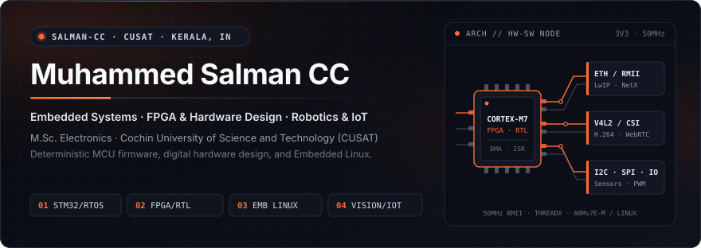
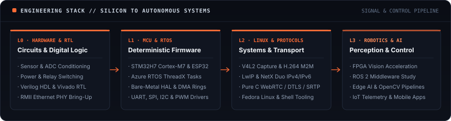
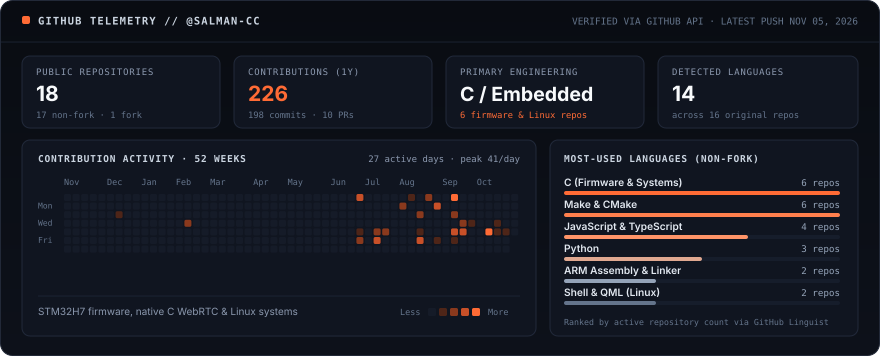

 

**Electronics and embedded systems developer working across hardware bring-up, deterministic C firmware, and Embedded Linux.** 
M.Sc. Electronics Student at <b>Cochin University of Science and Technology (CUSAT)</b> · Malappuram / Kochi, Kerala, India (UTC+05:30)

  

&nbsp;
&nbsp;
&nbsp;
&nbsp;

## `01` About Me

I am **Muhammed Salman CC**, an M.Sc. Electronics student at **Cochin University of Science and Technology (CUSAT)** with an undergraduate background in Electronics from the University of Calicut. My engineering work sits at the boundary where physical circuits, peripheral registers, and systems software have to agree with each other.

In practice, that means starting from datasheets and schematics rather than treating hardware as an abstraction: conditioning sensor front-ends and AC/DC switching stages, writing bare-metal DMA and Ethernet drivers on ARM Cortex-M7 microcontrollers (`STM32H7`), running real-time network stacks under Azure RTOS ThreadX and LwIP, and building single-binary C camera servers on Embedded Linux without heavy runtime dependencies.

Alongside microcontroller and Linux systems development, my academic work at CUSAT focuses on digital hardware design in Verilog HDL and Xilinx Vivado, investigating how FPGA spatial parallelism lowers latency and power consumption in robotic perception and edge intelligence pipelines.

  

| Background | Detail |
| :-- | :-- |
| **Graduate Study** | M.Sc. Electronics, Cochin University of Science and Technology (CUSAT) · *Expected 2027* (`Embedded Systems`, `FPGA Design`, `Robotics`, `DSP`, `Control Systems`) |
| **Undergraduate** | B.Sc. Electronics, Malabar College of Advanced Studies, University of Calicut (`Analog & Digital Electronics`, `Communication Systems`) |
| **Engineering Recognition** | District-level Young Innovators Programme (YIP) Winner for *Auto Hibernate for Inverters* (priority-based AC load-shedding controller) |
| **Industry & Community** | Former IoT Intern at Sparkiit (`ESP32` / `NodeMCU` firmware) · Founder of **AiCoN Tech Hub** (open-source, Linux, and AI technical education) |

## `02` Technical Expertise

Technologies are grouped by engineering domain and separated into <b>Demonstrated</b> (backed by public repositories, bench hardware, or completed coursework) and <b>Exploring</b> (active study and ongoing experimentation).

| Domain | Demonstrated in Repositories & Lab Work | Currently Exploring |
| :-- | :-- | :-- |
| **Embedded Systems** | `STM32H7 (Cortex-M7)` `ESP32` `Arduino / ATmega328P` `Embedded C` `Azure RTOS ThreadX` `LwIP` `NetX Duo` `RMII Ethernet (LAN8742)` `UART / SPI / I2C / PWM` `Sensor & Relay Interfacing` | `FreeRTOS` `CAN Bus` `Low-Power Firmware Design` |
| **Hardware & FPGA** | `Verilog HDL` `Xilinx Vivado` `RTL & FSM Design` `Digital Electronics` `AC/DC Sensing & Load Switching` `Circuit Simulation (Proteus, Cadence Virtuoso)` | `SystemVerilog` `VHDL` `Pipelined FPGA Vision Cores` |
| **Programming** | `C (C11)` `Python` `JavaScript` `TypeScript` `Bash / POSIX Shell` `ARM Assembly & Linker Scripts` `QML` | `Modern C++ (Embedded & Robotics)` |
| **Robotics & AI** | `V4L2 & CSI Camera Capture` `Hardware H.264 M2M Encoding` `Low-Latency WebRTC / RTP Transport` `FPGA Robotic Perception Study` | `ROS 2` `Computer Vision (OpenCV)` `Machine Learning & Edge AI` |
| **Tools & Platforms** | `Linux (Fedora, Debian, Raspberry Pi OS)` `STM32CubeIDE / CubeMX` `GNU Arm Toolchain` `Git & GitHub Actions` `Make & CMake` `Wireshark` `GNU Radio` `Firebase` `VS Code` | `Embedded Linux Build Systems (Buildroot / Yocto)` |

## `03` Featured Engineering Projects

Selected from my public repositories based on hardware integration, systems complexity, and documentation depth. Status labels reflect actual repository state.

<table>
  <tr>
    <td width="50%" valign="top">

<code>STM32H7 · BARE-METAL ETHERNET</code>

### [H753ZI_UDP_Test ↗](https://github.com/salman-cc/H753ZI_UDP_Test)

Deterministic UDP-over-Ethernet firmware for the **Nucleo-H753ZI** (`STM32H753ZITx`, ARM Cortex-M7) driving an external `LAN8742` RMII PHY without an RTOS.

- **Engineering purpose:** Implements the LwIP-to-ETH MAC glue (`ethernetif.c`) from scratch against STM32Cube H7 HAL v1.13 callback-managed RX DMA descriptor pools, verifying wire-exact 92-byte Ethernet/IPv4/UDP frames in Wireshark and documenting 50 MHz `REF_CLK` hardware strapping requirements.
- **Stack:** `C` `STM32H7 HAL` `LwIP` `RMII / LAN8742` `DMA` `ARM GCC` `Wireshark`

    </td>
    <td width="50%" valign="top">

<code>RTOS · DUAL-STACK IPV4 / IPV6</code>

### [crispy-octo-computing-machine ↗](https://github.com/salman-cc/crispy-octo-computing-machine)

Real-time networked control and telemetry node on **NUCLEO-H743ZI2** (`STM32H743ZIT6`, Cortex-M7) running **Azure RTOS ThreadX 6.2** and **NetX Duo 6.2**.

- **Engineering purpose:** Pairs inbound dual-stack IPv4/IPv6 UDP command handling (port 6000) with software-debounced GPIO button telemetry and `USART3` serial instrumentation, including manual IPv6 stack bring-up beyond default STM32CubeMX code generation.
- **Stack:** `C` `STM32H743` `Azure RTOS ThreadX` `NetX Duo` `IPv4 / IPv6 UDP` `USART`

    </td>
  </tr>
  <tr>
    <td width="50%" valign="top">

<code>EMBEDDED LINUX · REAL-TIME VIDEO</code>

### [cam (camstream) ↗](https://github.com/salman-cc/cam)

Single-binary, zero-runtime WebRTC camera server (~18k lines of C) streaming live V4L2 or Raspberry Pi CSI video directly to a browser tab over LAN.

- **Engineering purpose:** Replaces heavy media frameworks (GStreamer, Janus, Node.js) on resource-constrained Linux SBCs by implementing refcounted zero-allocation frame pools, V4L2 M2M hardware H.264 encoding with `libx264` fallback, ICE-lite, DTLS 1.2, SRTP, NACK retransmission, and mDNS discovery in pure C.
- **Stack:** `C11` `V4L2 / CSI` `H.264 M2M` `WebRTC (DTLS / SRTP / RTP)` `OpenSSL` `libsrtp2` `Makefile`

    </td>
    <td width="50%" valign="top">

<code>HARDWARE BRING-UP · 55 SENSORS & 14 BOARDS</code>

### [Embedded-Projects ↗](https://github.com/salman-cc/Embedded-Projects)

Structured hardware engineering reference covering **55 sensors** and **14 development boards** (STM32, ESP32, Arduino, RP2040, Teensy) backed by a Python catalog generator.

- **Engineering purpose:** Standardizes bench bring-up by pairing authoritative datasheet pinouts, generated SVG pin-reference diagrams, physical sensing notes, part trade-offs, and two-stage firmware verification recipes before application logic is written.
- **Stack:** `Embedded C` `STM32` `ESP32` `Arduino` `I2C / SPI / UART` `Python` `SVG`

    </td>
  </tr>
  <tr>
    <td width="50%" valign="top">

<code>FPGA & ROBOTICS · ACTIVE RESEARCH</code>

### [FPGA-Vision-Processing ↗](https://github.com/salman-cc/FPGA-Vision-Processing)

M.Sc. Electronics research and RTL study repository at CUSAT examining FPGA-based image processing architectures for autonomous robotics *(active development)*.

- **Engineering purpose:** Evaluates how hardware-level spatial parallelism on FPGAs addresses real-time latency and power constraints in obstacle detection, feature extraction, and stereo vision compared against sequential CPU vision execution.
- **Stack:** `FPGA` `Verilog` `VHDL` `Computer Vision` `Autonomous Robotics`

    </td>
    <td width="50%" valign="top">

<code>LINUX SYSTEMS · WAYLAND SHELL</code>

### [fedlock ↗](https://github.com/salman-cc/fedlock)

Custom user-scoped KDE Plasma 6.7 Wayland lock-screen shell (`Plasma/Shell`) engineered for **Fedora 44** with safe user-space installation and rollback scripts.

- **Engineering purpose:** Integrates cleanly with Plasma 6.7's `kscreenlocker_greet` architecture using QML/Qt 6 while strictly isolating user configuration inside `~/.local/share/plasma/shells/` without touching system files or PAM authentication boundaries.
- **Stack:** `QML` `Qt 6` `KDE Frameworks 6` `Wayland` `Bash` `Fedora Linux`

    </td>
  </tr>
</table>

### Additional Public Repositories

| Repository | Domain | Engineering Summary | Stack |
| :-- | :-- | :-- | :-- |
| [**legendary-chainsaw**](https://github.com/salman-cc/legendary-chainsaw) | Linux Camera Pipeline | Portable C11 V4L2 frame grabber and embedded HTTP/WebSocket server streaming raw YUYV video to an HTML5 canvas across x86-64 and ARM Linux. | `C11` `V4L2` `WebSocket` |
| [**JKSS-FUND**](https://github.com/salman-cc/JKSS-FUND) | Mobile & Cloud Systems | Android hostel fund ledger with integer-paise accounting, atomic 10%/90% job splits, hardened Firestore security rules, and CSPRNG local provisioning. | `JavaScript` `Expo` `Firebase` |
| [**Linux-Scripts**](https://github.com/salman-cc/Linux-Scripts) | Systems & Automation | Fedora automation scripts and a 20-section Linux command internals library covering exit codes, flags, diagnostics, and RHCSA/LPIC notes. | `Bash` `Linux` `Fedora` |
| [**Arduino-IoT**](https://github.com/salman-cc/Arduino-IoT) | Connected Hardware | ESP32 and Arduino IoT node experiments integrating environmental/power sensing with MQTT and cloud telemetry *(active development)*. | `ESP32` `Arduino` `MQTT` |
| [**muhammed-salman-portfolio**](https://github.com/salman-cc/muhammed-salman-portfolio) | Engineering Portfolio | Personal portfolio site (`muhammed-salman-cc.is-a.dev`) built with hand-authored CSS design tokens, dual themes, and automated `axe-core` accessibility tests. | `TypeScript` `React 19` `Vite` |

## `04` GitHub Statistics & Activity

Generated directly from the GitHub REST and GraphQL APIs into a repository-hosted SVG (`assets/github-telemetry.svg`) so telemetry renders reliably without third-party widget downtime or rate-limit errors.

  

<!-- COUNTERS:START -->
**Snapshot** ([all 19 public repositories](https://github.com/salman-cc?tab=repositories)): `11` original repositories · `255` contributions in the past year (`218` commits) · Core stack: `C, JavaScript & TypeScript, ARM Assembly & Linker, Python` · Latest push: `Nov 05, 2026`
<!-- COUNTERS:END -->

<b>Recent Public GitHub Activity</b> (auto-refreshed from GitHub Events API)

 

<!-- ACTIVITY:START -->
- **Push** in [salman-cc/salman-cc.github.io](https://github.com/salman-cc/salman-cc.github.io): updated `portfolio-site`, 3 days ago
- **Create** in [salman-cc/salman-cc.github.io](https://github.com/salman-cc/salman-cc.github.io): branch `portfolio-site`, 3 days ago
- **Create** in [salman-cc/cam](https://github.com/salman-cc/cam): branch `fix/au-slot-capacity`, 8 days ago
- **Push** in [salman-cc/FPGA-Vision-Processing](https://github.com/salman-cc/FPGA-Vision-Processing): updated `main`, 8 days ago
- **Create** in [salman-cc/Linux-Scripts](https://github.com/salman-cc/Linux-Scripts): branch `content/utility-scripts`, 8 days ago
<!-- ACTIVITY:END -->

## `05` Current Focus

Areas I am actively studying, prototyping, and documenting during my M.Sc. Electronics work at CUSAT:

- **Advanced Embedded Systems:** High-speed ARM Cortex-M7 peripherals, zero-copy DMA descriptor rings, hardware timer synchronization, and deterministic driver architecture from bare-metal register specs.
- **Real-Time Operating Systems:** Deterministic task scheduling, inter-task synchronization, memory pool discipline, and embedded TCP/IP and UDP stacks across **Azure RTOS ThreadX** and **FreeRTOS**.
- **FPGA Architecture & Digital Design:** Synthesizable **Verilog / SystemVerilog** RTL, pipelined datapaths, finite-state machines, and timing-aware digital systems verification in **Xilinx Vivado**.
- **Robotics & Intelligent Automation:** **ROS 2** communication graphs, low-latency embedded camera/sensor ingestion, hardware-timed actuation, and autonomous mobile robot fundamentals.
- **AI-Enabled Hardware Applications:** Running compact computer vision pipelines and edge inference workloads across microcontrollers, Embedded Linux SBCs, and FPGA hardware accelerators.

## `06` Connect With Me

I am open to collaborations on embedded systems, Linux drivers and media pipelines, FPGA digital design, robotics projects, and engineering internships. Email is the fastest way to reach me.

| Channel | Verified Destination | Purpose |
| :-- | :-- | :-- |
| **Portfolio** | [salman-cc.github.io](https://salman-cc.github.io/) | Project case studies, academic background, and hardware notes |
| **Personal Email** | [ccmuhammedsalman@gmail.com](mailto:ccmuhammedsalman@gmail.com) | Engineering opportunities, project collaboration, and general inquiries |
| **University Email** | [muhammedsalmancc@pg.cusat.ac.in](mailto:muhammedsalmancc@pg.cusat.ac.in) | Academic research, CUSAT coursework, and laboratory correspondence |
| **LinkedIn** | [linkedin.com/in/muhammed-salman-cc-b7522433b](https://www.linkedin.com/in/muhammed-salman-cc-b7522433b) | Professional network and updates |
| **GitHub** | [github.com/salman-cc](https://github.com/salman-cc) | Source code, firmware repositories, and hardware documentation |

 

<b>Muhammed Salman CC</b> · M.Sc. Electronics, CUSAT · Kerala, India 
Read the datasheet first, measure on real hardware, and document what worked.

